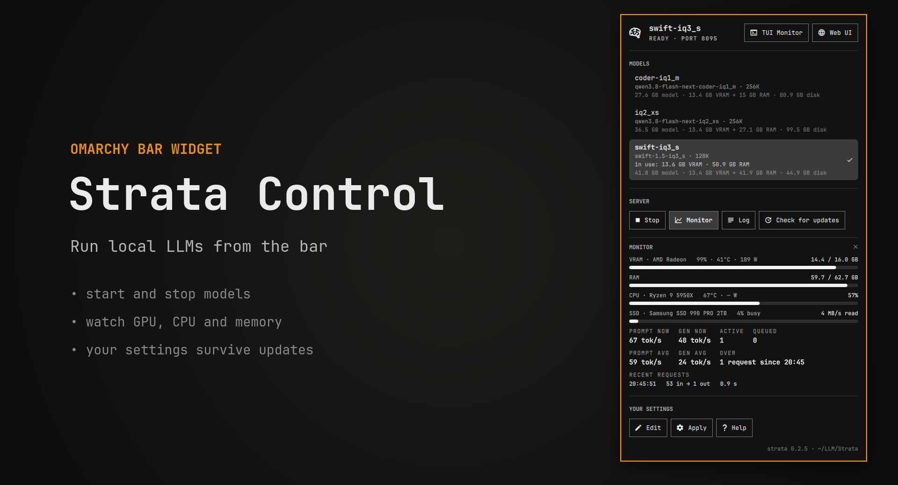
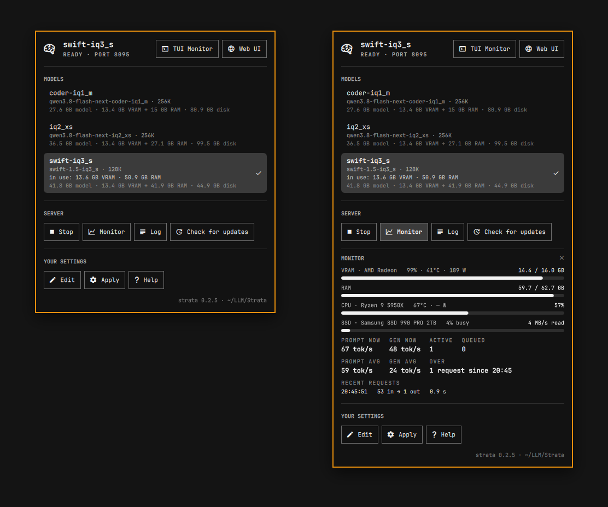
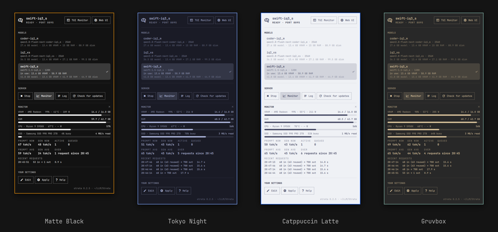

# Strata Control

An [Omarchy](https://omarchy.org) bar widget for [Strata](https://github.com/Niko1221/Strata), the local LLM server.
The icon shows whether a model is served. Click it to start and stop models, watch GPU, CPU and memory, follow the
log, update Strata, and keep your own model settings in one file that survives Strata updates.

This plugin is not part of Strata and not made by its authors; it drives Strata's own `strata` command.



## Quick start

1. Have Strata installed with at least one model (`strata launch`, see Strata's README). `strata models list` should
   show it.
2. Install and enable the plugin:

   ```sh
   omarchy plugin add https://github.com/schmittcn/omarchy-strata-control --enable
   ```

3. Click the new icon in the bar and click a model. It starts; the header turns to "Ready" when it answers.
   **Web UI** opens its chat page, **Monitor** shows what the GPU and CPU are doing, **Stop** frees the memory.

**Good to know:** when a model starts, the plugin checks the running Strata for known security problems and
shows a warning with what to change (see [Privacy](#privacy)). As of 2026-10-26 every Strata release has some of
them, so expect warnings; the model runs either way.

That is all you need. To change how a model runs (context, port, VRAM headroom, ...), press **Edit** under
"Your settings": see [Your model settings](#your-model-settings-patchesjson).

## What you need

| Needs | For | Without it |
|---|---|---|
| Omarchy with its shell (the Quickshell bar) | everything | - |
| Strata's `strata` command, 0.2.1 or newer, with at least one model set up | everything | the popup says the command is not found, or "No models found" |
| `python3` (the system one, no packages) | the helper `strata-profiles.py` | the popup says "No answer from strata-profiles.py: is python3 installed?" |
| `findmnt`, `lsblk` (util-linux, on every Arch install) | the SSD bar in the mini monitor | the SSD bar is left out |
| ROCm (AMD) or `nvidia-smi` (NVIDIA) | the measured "in use" VRAM | no "in use" line; the estimate stays |
| a readable RAPL counter | CPU watts | "— W" (see [CPU power](#cpu-power)) |
| a Strata without the known problems in [Privacy](#privacy) | no warnings at start | the model runs; the popup warns and says what to change |

**Edit** uses `$VISUAL` or `$EDITOR`, else nvim (which Omarchy ships).

## Using it

The bar icon is dim while no model is ready; its tooltip names the model and its state.



| Part of the popup | What it does |
|---|---|
| Header | The served model, its state (starting, ready, stopping) and port. **TUI Monitor** opens `strata monitor` in a terminal; **Web UI** opens the model's chat page in your browser. |
| Models | Every model Strata knows: id, name, context, size, how much VRAM and RAM it takes on this PC and its space on disk. Click one (or arrows and Enter) to start it; a running model is stopped first. ✓ marks the served one. |
| Server | **Stop** frees GPU and RAM. **Monitor** opens the mini monitor. **Log** follows the server log in a terminal. **Check for updates** only asks; when there is one, the button becomes **Install update**, which runs the update in a terminal. |
| Your settings | **Edit** opens your settings file and applies it when you close the editor. **Apply** applies it now. **Help** shows the format. |
| Footer | Which Strata answers: version and install folder. |

Command output appears below the buttons; click it, or the same button again, to close it. Keys: arrows move through
the models, Enter starts one, Esc closes the popup.

**Memory per model.** "13 GB VRAM + 27.5 GB RAM" is Strata's own estimate for this PC, the one `strata launch`
shows. A model Strata's catalog does not know gets the same formula on the size of its weights, marked `~`. Your
VRAM headroom settings are counted. The estimate assumes a 32K conversation memory, so long contexts need more VRAM
than it says (a 256K context with a q8_0 cache: about 3 GiB more). "disk" counts every file the model uses.
The running model gets one more line, "in use": what it really takes, measured from the GPU driver and the process.

**Mini monitor** (Monitor button). Updated every 2 seconds while it is open, nothing is polled while it is closed:

- VRAM per GPU with load, temperature and power, then RAM.
- CPU load, temperature and power.
- The drive with the model's weights: read speed and how busy it is. Strata reads from it while a model loads and
  when the weights do not fit in RAM.
- Prompt and generation speed now and their averages over the recent requests.
- Active, queued and the last four requests.

The bar itself checks the state every 30 seconds (setting below).

The popup follows your Omarchy theme:



**From the shell**, e.g. for a keybind:

```sh
omarchy-shell io.github.schmittcn.strata-control toggle    # also: open, close
omarchy-shell io.github.schmittcn.strata-control monitor   # open with the mini monitor
```

## Widget settings

In Omarchy's settings for the widget, or in its entry in `~/.config/omarchy/shell.json`:

| Setting | Default | Meaning |
|---|---|---|
| `refreshIntervalSec` | `30` | Seconds between state checks while the popup is closed. |
| `strataCommand` | `strata` | The strata command to use (see [A source checkout or fork](#a-source-checkout-or-fork)). |
| `updateCheckCommand` | empty | Command for **Check for updates**; empty means `strata update --check`. Output containing "update available" turns the button into **Install update**. |
| `updateCommand` | `strata update` | What **Install update** runs in a terminal. |

## Your model settings: patches.json

Strata's setup and updates rewrite its run configs, so settings you change there by hand get lost. This plugin keeps
yours in `~/.config/strata/patches.json` and lays them over Strata's configs every time a model starts.

With an empty file (the default) models run exactly as Strata set them up.

**Example.** Serve every model on port 8095, give the Coder models a shorter context and their own sampling, and
leave 2 GiB of VRAM free for the desktop:

```json
{
  "*": {
    "profile": {"port": 8095}
  },
  "coder-*, swift-*": {
    "args": {"--vram-reserve-mib": "2700"}
  },
  "coder-*": {
    "args": {"--max-context": "131072"},
    "set": {"sampling": {"temperature": 0.6, "top_p": 0.95, "top_k": 20}}
  }
}
```

Keys are model ids from `strata models list`, with `*` wildcards; several are separated by commas. Every matching
entry applies, top to bottom, so put general entries first and specific ones after.

| Part | What it changes |
|---|---|
| `args` | Engine arguments. `"--flag": "value"` sets or adds the flag, `true` adds a flag without value, `null` or `false` removes it. |
| `env` | Environment variables of the server; `null` removes one. |
| `set` | Top-level config keys (`sampling`, `vision`, ...), replaced whole; `null` removes the key. |
| `profile` | Serving settings: `host`, `port`, `parallel`, `batch_groups`, `max_queue`, `queue_timeout`, `offline`, `batch_telemetry`. |

Which engine arguments exist depends on the model; Strata's
[docs/DETAILS.md](https://github.com/Niko1221/Strata/blob/main/docs/DETAILS.md) lists them, and
`strata models inspect <id>` names a model's run config with its current ones.

After **Edit** the change is applied when you close the editor; start the model again to use it.

### Leaving VRAM for the desktop

A model that fills the graphics memory leaves the desktop no room: the mouse and windows can stutter. Two arguments
keep VRAM free:

- `--vram-reserve-mib N` (most models: Qwen3.8 Coder, Swift, ...): VRAM kept free when the engine sizes its expert
  cache. The engine allocates a few hundred MiB more afterwards (about 650 MiB on a 16 GB card), so for 2 GiB really
  free set about 2700.
- `--expert-vram GiB` (Qwen3.6-35B-A3B models, `"arch": "qwen35moe"` in the run config): these ignore the
  reserve and fill the VRAM. The value caps the experts' share; lower leaves more room but answers slower. The engine
  log (`strata-<id>.log` in the Strata folder) shows the VRAM free before the experts ("... GiB of VRAM free"). For
  N GiB left free: cap = that figure − N − about 0.5 (0.7 with the picture reader on). Check with the mini monitor.

### How it works

**Apply** (also done right before a model starts) copies each run config to `~/.config/strata/configs/<id>.json` with
your settings on top, and points a Strata profile named `omarchy-<id>` at that copy. Models start and stop with
`strata runtime --profile omarchy-<id>`. Strata's updates never touch the copies; the next start applies again.

A profile named `omarchy-<id>` that points anywhere else is yours: the plugin leaves it alone, says so, and does not
start that model.

## A source checkout or fork

`strata runtime` serves the code of the strata command's own Strata copy. If you run Strata from a git checkout, point
the plugin at that checkout's command (absolute paths, `~` is not expanded):

```json
"strataCommand": "env STRATA_PYTHON=/path/to/Strata/.venv/bin/python /path/to/Strata/bin/strata"
```

The footer shows which version answers. For a fork kept on top of upstream, point the update buttons at your own
script, e.g. one that rebases onto upstream, rebuilds and runs `strata-profiles apply`:

```json
"updateCheckCommand": "my-strata-update --check",
"updateCommand": "my-strata-update"
```

## CPU power

Linux lets only root read the CPU's energy counter (RAPL), because of the Platypus side channel
(CVE-2020-8694/8695), so the monitor shows "— W" by default. On a single-user desktop you can make it readable,
knowing that every program you run can then read the CPU's energy use. As root:

```sh
# until the next boot
chmod a+r /sys/class/powercap/intel-rapl:0/energy_uj
# every boot
echo 'SUBSYSTEM=="powercap", ACTION=="add", RUN+="/usr/bin/chmod a+r /sys%p/energy_uj"' > /etc/udev/rules.d/90-rapl-read.rules
```

## Privacy

- The patched run configs in `~/.config/strata/configs/` can hold your server's `api_key`; the plugin keeps them
  readable by you only (0600 in a 0700 folder), like Strata's own profiles.
- **Known problems in Strata.** The plugin runs Strata as it is and does not change Strata's code or packages; it
  is maintained separately from Strata (report problems in Strata to Strata, see its
  [security policy](https://github.com/Niko1221/Strata/blob/main/SECURITY.md)). When a model starts, the plugin
  checks the code and the Python the started server actually runs (the server process's folder and interpreter,
  which can differ from the folder your models are in) for these known problems, and warns with what to change.
  The model runs either way:

  | Safe when | Why it matters | Fixed in Strata by | What you can do until then |
  |---|---|---|---|
  | The web page only fills in a question from a `/?q=...` link, it does not send it | Any page can link there; the request would carry the browser's saved API key and its MCP tools | [Niko1221/Strata#4221](https://github.com/Niko1221/Strata/pull/4221) | don't open `?q=` links to your Strata from sources you don't trust, especially with MCP tools on |
  | With the picture reader on (`"vision"` in the run config): Pillow 13.0.0 or newer, or no Pillow, in the server's Python | Pillow before 13 has known image-decoding vulnerabilities ([GHSA-78g4-xqwv-q3g8](https://github.com/python-pillow/Pillow/security/advisories/GHSA-78g4-xqwv-q3g8) and others) | [Niko1221/Strata#4220](https://github.com/Niko1221/Strata/pull/4220) | update Pillow in your Strata's environment (a source checkout's `.venv`, Python 3.11+), or turn the picture reader off for the model: `"set": {"vision": null}` in patches.json |
  | With image generation on (`"images"`): prompts go to `sd-cli` in a private file | On the command line, other accounts on this PC can read them ([#4202](https://github.com/Niko1221/Strata/issues/4202)) | [Niko1221/Strata#4204](https://github.com/Niko1221/Strata/pull/4204) | turn image generation off (`setup --images no`) |

  As of Strata `main` 4b9e05a2 (2026-10-25) none of these fixes is merged, so an unchanged Strata gets warnings.
  Once a Strata release has them, the warnings go away without a plugin update.

## The helper from a terminal

The popup's work is done by `strata-profiles.py` in the plugin folder, which also runs on its own:

```sh
ln -s ~/.config/omarchy/plugins/io.github.schmittcn.strata-control/strata-profiles.py ~/.local/bin/strata-profiles
```

```
strata-profiles apply [ID..]   apply your settings (all models by default)
strata-profiles start ID       stop what runs, apply ID, start it and wait until it is ready
strata-profiles stop           stop the running model
strata-profiles edit           create patches.json if missing and print its path
strata-profiles info           JSON: models and their state
strata-profiles details        JSON: strata version, size and memory per model
strata-profiles status         JSON: server snapshot plus CPU
strata-profiles update-check   is there a newer Strata?
```

`STRATA_CLI` picks the strata command, as `strataCommand` does in the plugin.

## Files

| Path | What |
|---|---|
| `~/.config/strata/patches.json` | Your settings. |
| `~/.config/strata/configs/<id>.json` | The patched run configs (rebuilt by Apply; do not edit). Readable by you only, like Strata's own profiles: a run config can hold the server's `api_key`. |
| `~/.config/strata/profiles/omarchy-<id>.json` | The plugin's Strata profiles, one per model. |
| `~/.local/state/strata/runtime/omarchy-<id>.server.log` | The server log (**Log**). |
| `strata-<id>.log` in the Strata folder | The engine log: placement, VRAM, speed. |
| `~/.config/omarchy/shell.json` | The widget settings. |

## Troubleshooting

- **"No models found".** `strata models list` (or your `strataCommand`) finds no model; set one up with Strata first.
- **A model shows "files incomplete" or does not start.** **Log**, or `strata models inspect <id>` to check its files.
- **"... not this tool's" when starting a model.** A profile named `omarchy-<id>` exists and points elsewhere. Move its
  file out of `~/.config/strata/profiles/` (`strata profile` has no delete) and press Apply.
- **A model is missing that `strata` in a terminal shows** (or the other way round): the plugin uses another Strata
  copy than your terminal; set `strataCommand`.

Anything else, or an idea: [open an issue](https://github.com/schmittcn/omarchy-strata-control/issues) with what you
clicked, what the popup showed, and the output of `strata --version`.

## Remove

```sh
omarchy plugin remove io.github.schmittcn.strata-control
```

A running model keeps running: stop it first, or later with `strata runtime stop --profile omarchy-<id>`. Your
settings and the `omarchy-*` profiles stay in `~/.config/strata/` (see [Files](#files)); delete them by hand if you
want.

## Development

- Clone into `~/.config/omarchy/plugins/io.github.schmittcn.strata-control` (a symlinked plugin folder fails to load
  with "File name case mismatch"; link the other way round to work on it from elsewhere), then
  `omarchy-shell shell rescanPlugins` and `omarchy plugin enable io.github.schmittcn.strata-control`.
- Saving reloads the plugin, but Qt can keep old QML cached: `omarchy restart shell`.
- `python3 test_strata_profiles.py` checks the patch rules; `omarchy-plugin-validate .` the manifest.

## License

Apache License 2.0, see [LICENSE](LICENSE).
